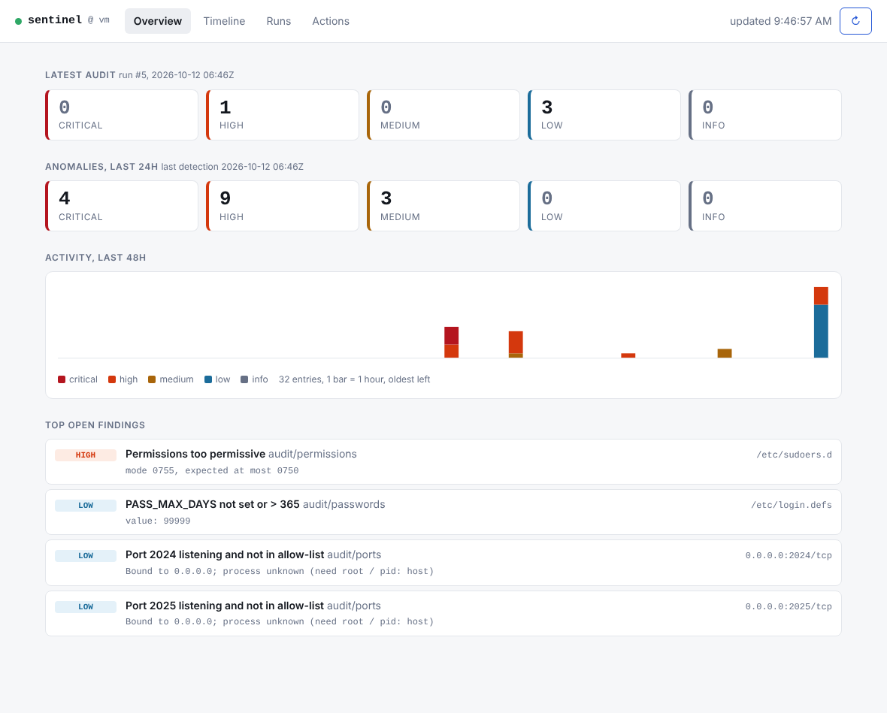

# The Sentinel

**Lightweight host security monitor in one process and one SQLite database:**

- **Audit** - posture checks: exposed ports, password/SSH policy, outdated packages, permissions on critical files.
- **Detect** - unsupervised ML on your logs. Every anomaly explains *why* (`auth_failures high, z=+10.2, top IP 185.220.101.4`).
- **One timeline** - audit findings and anomalies side by side, so "new port opened at 14:02" and "login failures spiked at 14:05" read as one story.

- **API + dashboard** - `sentinel serve` exposes everything over HTTP and a small web UI (no JS framework, no CDN, works offline).

Pure standard library for auditing; scikit-learn only for the ML half (`[ml]`), Starlette + uvicorn only for the web half (`[web]`):
`pip install "sentinel-monitor[ml,web]"`.
**Use only on systems you own or are authorized to assess.** Status: early alpha (0.1.0).

## Quick start (no root, no real logs needed)
    python3 -m venv .venv && . .venv/bin/activate
    pip install -e ".[ml,web]"
    sentinel audit                                   # posture audit of this machine (run with sudo for the full picture)
    sentinel demo --out-dir demo                     # synthetic logs: brute force, log silence, reverse shell, crash loop
    sentinel train  --file demo/normal.log
    sentinel detect --file demo/attack.log --lookback 30
    sentinel timeline --hours 48                     # audit findings + anomalies together
    sentinel serve                                   # dashboard + API on http://127.0.0.1:8080

## Using your real logs
Sentinel reads **plain-text logs, one event per line**, in either of two formats (anything else is silently skipped):

    Oct 12 10:27:01 web01 sshd[123]: Failed password for root from 1.2.3.4 port 22 ssh2     # classic syslog
    2026-10-12T10:27:01+00:00 web01 sshd[123]: Failed password for root from 1.2.3.4 ...   # ISO 8601 (also "2026-10-12 10:27:01")

i.e. `<timestamp> <host> <process>[pid]: <message>`. That covers `/var/log/auth.log` (Debian/Ubuntu), `/var/log/secure` (RHEL/Fedora),
`/var/log/syslog`, `/var/log/messages` and anything rsyslog writes. Not supported yet: the Windows Event Log (`.evtx`), journald binary
journals (export first: `journalctl --no-pager -o short-iso > journal.log`), JSON logs.

    # 1. learn "normal" from a CLEAN period - several days minimum, a week or more is better (needs >= ~4 h of events)
    sentinel train  --file /var/log/auth.log --file /var/log/auth.log.1        # rotated logs: gunzip them first
    # 2. look for anomalies in the recent past
    sentinel detect --file /var/log/auth.log --lookback 24                      # last 24 hours
    sentinel timeline --hours 48

    # 3. or make it permanent: sentinel.toml  ->  [detect] files = ["/var/log/auth.log"]
    sentinel daemon                      # trains itself on first start if no model exists, then checks every 5 minutes
    sentinel serve --with-daemon         # same, plus the dashboard

Tips: reading `/var/log/auth.log` needs root or membership of the `adm` group. Train on logs that contain no incident, or the incident becomes "normal".
Re-train after big changes (new service, new users). Expect some low-severity noise at first; raise `contamination` or filter with `--min-severity`.
Timestamps without a timezone are read as the host's local wall-clock time.

### Windows
- **Dashboard, API, log detection and the demo work natively on Windows** (`py -m venv .venv`, `.venv\Scripts\activate.bat` in cmd or `.venv\Scripts\Activate.ps1` in PowerShell, then `pip install -e ".[ml,web]"`).
  Use `.venv\Scripts\sentinel ...` if you skip activation. Typing a `.ps1` path in `cmd` opens Notepad: use PowerShell or the `.bat` script.
- **`sentinel audit` and the audit tests need Linux** (`/proc`, `/etc/shadow`, POSIX permissions, apt/dnf/apk). On Windows use WSL2 or a Linux VM/server.
- **Windows logs:** `scripts/win2log.ps1` (run as Administrator) exports logons (4624/4625), privileges (4672), account/group changes (4720/4732),
  new services (7045) and unexpected shutdowns (6008) into the format above. *Experimental - not yet tested on a real Windows host.*

        .\scripts\win2log.ps1 -Days 14 -Out windows.log
        .venv\Scripts\sentinel train  --file windows.log --model windows.npz
        .venv\Scripts\sentinel detect --file windows.log --model windows.npz --lookback 24

  In `sentinel.toml` write Windows paths as TOML literal strings: `files = ['C:\logs\windows.log']`.

## Commands
| Command | What it does |
|---|---|
| `audit` | Run checks now (`--checks`, `--allow-ports 22,443`, `--host-root`, `--fail-on high` -> exit 2) |
| `train` / `detect` | Learn normal / find anomalies. Source: `--file` (log files) or `--audit-history` (past audits, one window per run) |
| `daemon` | Audits every N hours + detection every N minutes, forever (`--once` for a single pass). Trains itself if no model exists yet |
| `timeline` | Everything on one time axis (`--hours`, `--min-severity`) |
| `serve` | HTTP API + web dashboard (`--host`, `--port`, `--with-daemon` to also run the audit/detect loop in the same process) |
| `history`, `show ID [--logs]`, `diff A B` | Browse runs, see run logs, new/resolved findings between two runs |
| `config`, `demo` | Print effective settings / write demo logs |

Use a separate `--model` file per source: a model trained on log files cannot score audit history (and vice versa).

## Dashboard and API
`sentinel serve` listens on `127.0.0.1:8080`. Tabs: **Overview** (latest audit, anomalies in 24h, 48h activity chart, top findings),
**Timeline** (audit + anomalies on one axis), **Runs** (findings, logs, diff against the previous run), **Actions** (run audit / detection / training).

Security defaults:
- Loopback only. Listening on anything else is refused unless `SENTINEL_API_TOKEN` (or `[api] token`) is set (`--allow-open` overrides, for a port mapping / reverse proxy you trust).
- With a token, every `/api/*` call needs `Authorization: Bearer <token>` (the dashboard asks for it and keeps it in the tab's sessionStorage).
- **POST actions exist only when a token is set** (and `[api] actions = true`). Without a token the API is strictly read-only.
- Without a token the `Host` header is checked (DNS-rebinding protection); a strict CSP forbids inline scripts and the UI renders log text with `textContent` only.
- No TLS built in: put it behind a reverse proxy (Caddy, nginx) if it leaves the machine.

| Endpoint | |
|---|---|
| `GET /api/health`, `/api/info` | liveness; version / auth / actions flags (no token needed) |
| `GET /api/summary` | latest audit + counts, latest detection, anomalies in 24h |
| `GET /api/runs?kind=&limit=` | list runs |
| `GET /api/runs/{id}`, `/api/runs/{id}/logs` | findings (worst first) / stored log lines |
| `GET /api/diff?old=&new=` | new and resolved findings between two runs |
| `GET /api/timeline?hours=&min_severity=&limit=` | audit findings + anomalies on one time axis |
| `GET /api/config` | effective settings (token masked) |
| `POST /api/actions/audit` `{"checks": [...]}` | run an audit now |
| `POST /api/actions/detect` `{"lookback_hours": 24, "audit_history": false}` | run detection now (409 if another run is active) |
| `POST /api/actions/train` | retrain from the configured log files |

    export SENTINEL_API_TOKEN=$(openssl rand -hex 24)
    sentinel serve --with-daemon          # one process: audits + detection + dashboard
    curl -H "Authorization: Bearer $SENTINEL_API_TOKEN" localhost:8080/api/summary

## Configuration
`sentinel.toml` (see `sentinel.example.toml`), looked up via `--config`, `$SENTINEL_CONFIG`, `./sentinel.toml`, `/etc/sentinel/sentinel.toml`.
Precedence: defaults < file < environment (`SENTINEL_DB`, `SENTINEL_MODEL`, `SENTINEL_HOST_ROOT`, `SENTINEL_API_TOKEN`) < CLI flags. Typos in the file are errors, not silently ignored.

## Docker
    # edit docker/sentinel.toml first (allowed ports, log path)
    docker compose up -d --build
    docker compose logs -f sentinel
    docker compose run --rm sentinel timeline
    # dashboard: http://127.0.0.1:8080  (the `web` service, read-only view of the shared database)
The `sentinel` service is root, with the host mounted read-only at `/host`, host network and PID namespace. Nothing on the host is modified.
The `web` service has no host access, publishes only on 127.0.0.1 and has no token, so it is read-only; to expose it, add a reverse proxy and `SENTINEL_API_TOKEN`.
(The image and compose file are untested in CI so far - see Status.)

## How it works
    sentinel audit / daemon            sentinel train / detect
        |  checks (plugins)                |  parse -> templates -> windows -> features
        v                                  v  IsolationForest + never-seen-pattern detector
    runs + findings(source=audit)   runs + findings(source=anomaly)        <- same SQLite DB
                      \\                   /
                       `-- timeline / diff / history / API + dashboard (sentinel serve)`

- Two detectors share the window features: an IsolationForest, plus a z-score gate (a single feature >= 7 sigma from normal is
  always reported - IsolationForest scores saturate, which used to hide long log silences).
- Log lines are masked into *templates* (IPs, users, numbers removed). Windows (default 5 min, empty ones kept) get features:
  event count, idle streak, error ratio, auth failures, distinct IPs, top-IP share, entropy, time of day, top-25 template counts.
- Severity is graded by the strongest deviation (z-score); never-seen patterns are raised higher if they look like auth failures or
  suspicious commands (`nc -e`, `curl | sh`, root password login...).
- Model files are NumPy + JSON (`allow_pickle=False`); the forest is rebuilt deterministically on load.
- Schema changes go through numbered migrations (`PRAGMA user_version`).

## Write your own check
    # mypkg/checks.py
    from sentinel.models import Config, Finding
    def run(cfg: Config) -> list:
        return [Finding("mycheck", "medium", "Something is off", "details", "/some/target")]

    # mypkg's pyproject.toml
    [project.entry-points."sentinel.checks"]
    mycheck = "mypkg.checks:run"
Then add `"mycheck"` to `[audit] checks`. Use `cfg.path("/etc/x")` so it works on a mounted host root.

## Limits (honest notes)
- Unsupervised ML finds *unusual*, not *malicious*; expect some low-severity noise and tune `contamination`. Train on a clean period.
- Audit is Linux only (log detection also runs on Windows/macOS). TCP only (no UDP yet). Package checks: apt, apk, dnf; no CVE matching yet.
- Syslog lines carry no year/timezone: current year and host-local wall clock are assumed. Log formats: see *Using your real logs*.
- Tested on Debian/Ubuntu-style systems only. Not a replacement for a full SIEM/EDR.

## Roadmap
multi-host agents and alerts (Slack/mail/webhook) -> CVE matching (OSV), SUID inventory, container audits, journald/JSON logs.

## Migrating from the earlier `secaudit` / `logsentinel` prototypes
Not automatic: the new database has a different schema. Start fresh with `sentinel audit` (old files can stay as an archive).
